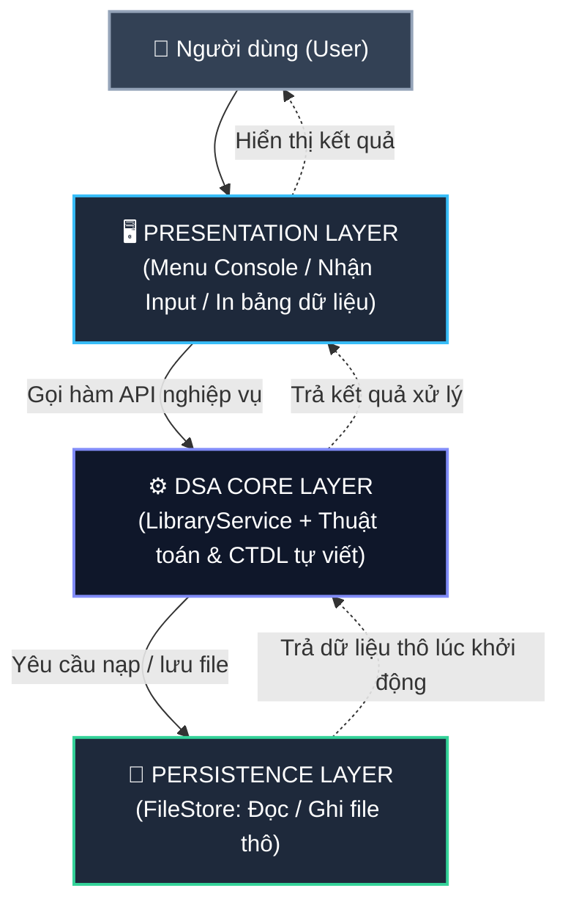

# 📚 HỆ THỐNG QUẢN LÝ THƯ VIỆN & MƯỢN - TRẢ SÁCH (LIBRARY ENGINE)
> **Học phần:** Cấu trúc Dữ liệu và Giải thuật (Data Structures and Algorithms - DASA230179)  
> **Lớp học phần:** `261DASA230179_06`  
> **Đồ án nhóm:** 50% điểm học phần  
> **Ngôn ngữ triển khai:** C++ (C++11 trở lên)

---

## 🏛️ 1. KIẾN TRÚC HỆ THỐNG 3 TẦNG (3-TIER ARCHITECTURE)

Hệ thống được thiết kế theo mô hình **Kiến trúc 3 Tầng** độc lập, phân định rõ ràng trách nhiệm giữa từng thành phần:



### Nguyên tắc phân tầng:
1. **Presentation Layer (Tầng Giao diện):** Chỉ tiếp nhận lựa chọn/dữ liệu từ người dùng và format in ra màn hình. Tuyệt đối **không** can thiệp trực tiếp vào cấu trúc dữ liệu hay duyệt tìm kiếm.
2. **DSA Core Layer (Tầng Xử lý & CTDL):** Nơi **duy nhất** chứa các cấu trúc dữ liệu tự cài đặt (Hash Table, Max-Heap, AVL Tree, Priority Queue) và thực thi các thuật toán.
3. **Persistence Layer (Tầng Lưu trữ):** Chỉ làm nhiệm vụ đọc/ghi file thô (`books.txt`, `readers.txt`, `tickets.txt`), không chứa logic nghiệp vụ hay thuật toán sắp xếp.

---

## 📊 2. BẢN ĐỒ ÁNH XẠ NGHIỆP VỤ ↔ CẤU TRÚC DỮ LIỆU

| Mã Yêu cầu | Tên Chức năng Nghiệp vụ | Cấu trúc Dữ liệu Đề xuất | Độ phức tạp Thời gian | Lý do Lựa chọn & Biện minh Thiết kế |
| :--- | :--- | :--- | :--- | :--- |
| **MC1** | Tra cứu sách theo Mã tài liệu | **Hash Table** (Separate Chaining) | $\mathcal{O}(1)$ TB / $\mathcal{O}(N)$ WC | Tra cứu theo khóa định danh duy nhất (Unique Key), tần suất đọc cao, không yêu cầu thứ tự sắp xếp. |
| **MC2** | Top $K$ sách có lượt mượn nhiều nhất | **Max-Heap** (Mảng động / Binary Heap) | Lấy Top: $\mathcal{O}(K \log N)$<br/>Cập nhật: $\mathcal{O}(\log N)$ | Truy vấn theo cực trị ưu tiên liên tục khi phát sinh lượt mượn mới mà không cần sắp xếp lại toàn bộ kho. |
| **RQ1** | Tra cứu sách theo Thể loại | **Hash Table phụ** (Category $\to$ List) | Tra nhóm: $\mathcal{O}(1)$<br/>Liệt kê: $\mathcal{O}(M)$ | Quan hệ 1-nhiều với số lượng thể loại hữu hạn, tránh quét toàn bộ mảng $\mathcal{O}(N)$. |
| **RQ2** | Theo dõi sách Đang mượn / Quá hạn | **Cây cân bằng (AVL / BST)** theo hạn trả | Truy vấn khoảng: $\mathcal{O}(\log N + M)$ | Quản lý theo thứ tự thời gian có cấu trúc ($<\text{ngày hiện tại}$), hỗ trợ range query tối ưu. |
| **RQ3** | Tìm kiếm theo Tên / Từ khóa | **Hash Thể loại + String Matching** | Thu hẹp nhóm $\to$ Khớp chuỗi | Tìm kiếm theo chuỗi con, tránh tạo bảng băm thứ 3 gây lãng phí bộ nhớ và lệch dữ liệu khi ghi. |
| **Waitlist**| Hàng chờ mượn khi sách hết kho | **Priority Queue / Max-Heap** | Enqueue/Dequeue: $\mathcal{O}(\log N)$ | Ưu tiên cấp phát theo loại thẻ bạn đọc (`VIP` > `Student` > `Normal`) kết hợp thời gian đến (`FIFO`). |

---

## 📁 3. CẤU TRÚC THƯ MỤC DỰ ÁN (MODULE HÓA)

```text
Project/
│
├── README.md                    # Tài liệu hướng dẫn & giải thích kiến trúc
├── main.cpp                     # Điểm khởi động chương trình & liên kết 3 tầng
│
├── models/                      # TẦNG 1: Models (Định nghĩa thực thể dữ liệu thô)
│   └── Models.h                 # struct TaiLieu, DocGia, PhieuMuon, WaitlistEntry
│
├── presentation/                # TẦNG 2: Presentation Layer (Giao diện người dùng)
│   ├── Menu.h                   # Khai báo menu console, giao diện in bảng
│   └── Menu.cpp                 # Triển khai hiển thị, đọc & validate input an toàn
│
├── dsa_core/                    # TẦNG 3: DSA Core Layer (Xử lý thuật toán & CTDL)
│   ├── LibraryService.h         # Khai báo API Facade của Core
│   ├── LibraryService.cpp       # Triển khai xử lý nghiệp vụ trung gian
│   ├── HashTable.h              # (Sắp tới) Bảng băm tự cài đặt cho MC1, RQ1
│   ├── MaxHeap.h                # (Sắp tới) Max-Heap tự cài đặt cho MC2
│   ├── AVLTree.h                # (Sắp tới) Cây tự cân bằng cho RQ2
│   └── PriorityQueue.h          # (Sắp tới) Hàng đợi ưu tiên cho Waitlist
│
├── persistence/                 # TẦNG 4: Persistence Layer (Lưu trữ tệp tin)
│   ├── FileStore.h              # Khai báo đọc/ghi file
│   └── FileStore.cpp            # Đọc/ghi dữ liệu thô
│
├── data/                        # Thư mục lưu dữ liệu mẫu JSON
│   ├── books.json               # Danh mục tài liệu mẫu
│   ├── readers.json             # Danh mục độc giả mẫu
│   ├── tickets.json             # Danh mục phiếu mượn mẫu
│   └── waitlist.json            # Danh mục hàng chờ mượn sách
│
└── docs/                        # Thư mục tài liệu yêu cầu & báo cáo môn học
    ├── BÁO CÁO D2_(2).docx       # Báo cáo đồ án D2
    ├── DSA-D3.docx              # Tài liệu D3
    ├── QUY TRÌNH ĐỒ ÁN DSA.docx # Quy trình thực hiện đồ án
    ├── YÊU CẦU ĐỒ ÁN NHÓM.docx  # Yêu cầu chi tiết đồ án
    └── kien-truc-3-tang (1).md  # Tài liệu phân tích kiến trúc 3 tầng chi tiết
```

---

## 🛠️ 4. HƯỚNG DẪN BIÊN DỊCH & CHẠY DỰ ÁN

### 4.1. Yêu cầu môi trường
* **Trình biên dịch:** `g++` (MinGW / GCC) hỗ trợ **C++11** trở lên.
* **Hệ điều hành:** Windows (PowerShell / Command Prompt / Terminal trong VS Code).

---

### 4.2. Cách biên dịch & chạy nhanh bằng dòng lệnh (Terminal / PowerShell)

#### Bước 1: Mở Terminal tại thư mục `Project`
```bash
cd c:\Users\TuyetNhi\Documents\workspace\dsa_tt_15-main\Project
```

#### Bước 2: Biên dịch tất cả các file mã nguồn
```bash
g++ -std=c++11 main.cpp presentation/Menu.cpp dsa_core/LibraryService.cpp persistence/FileStore.cpp -o app.exe
```

#### Bước 3: Chạy chương trình
```bash
./app.exe
```

*(💡 **Mẹo:** Nếu bạn dùng MinGW trên Windows, có thể dùng lệnh gom nhanh: `g++ -std=c++11 main.cpp */*.cpp -o app.exe`)*

---

### 4.3. Cách chạy bằng các IDE (VS Code, Visual Studio, Code::Blocks, Dev-C++)
1. **Visual Studio Code:**
   * Mở thư mục `Project` trong VS Code (`File` $\to$ `Open Folder...`).
   * Mở Terminal tích hợp (`Ctrl + ~` hoặc `Terminal` $\to$ `New Terminal`).
   * Chạy lệnh biên dịch ở Bước 2 & 3 như trên.
2. **Code::Blocks / Visual Studio:**
   * Tạo **New C++ Console Project**.
   * Thêm tất cả file `.h` và `.cpp` trong các thư mục `models/`, `presentation/`, `dsa_core/`, `persistence/` và `main.cpp` vào project.
   * Đảm bảo cấu hình compiler bật `-std=c++11`.
   * Nhấn **Build & Run (F9 / F5)**.

---

### 4.4. Hướng dẫn Test các chức năng trên Menu (Dữ liệu mẫu)

Sau khi chạy `./app.exe`, hệ thống sẽ nạp dữ liệu từ `data/*.json` và hiển thị bảng menu:

| Lựa chọn Menu | Chức năng nghiệp vụ | Dữ liệu mẫu gợi ý để nhập | Kết quả kỳ vọng hiển thị |
| :---: | :--- | :--- | :--- |
| **`1`** | **[MC1] Tra cứu theo Mã** | Nhập `B01` hoặc `B04` | In bảng chi tiết thông tin sách, tồn kho, tác giả. |
| **`2`** | **[MC2] Top K mượn nhiều nhất**| Nhập số `3` hoặc `5` | In danh sách Top K sách có lượt mượn cao nhất giảm dần. |
| **`3`** | **[RQ1] Tra cứu theo Thể loại** | Nhập `CNTT` hoặc `KinhTe` | In toàn bộ danh mục sách thuộc đúng thể loại đó. |
| **`4`** | **[RQ2] Kiểm tra sách quá hạn** | Nhập ngày `2026-09-20` | Tự động phân loại 2 bảng: Phiếu đang trong hạn & Phiếu cảnh báo quá hạn. |
| **`5`** | **[RQ3] Tìm theo tên / từ khóa**| Nhập `Hoc May` hoặc `Clean` | Tìm và in danh sách sách có tên khớp với từ khóa. |
| **`6`** | **[Xem] Toàn bộ kho sách** | *(Không cần nhập)* | In bảng toàn bộ 15 cuốn sách hiện có trong cơ sở dữ liệu. |
| **`0`** | **Thoát chương trình** | *(Không cần nhập)* | Lưu trữ trạng thái và đóng ứng dụng an toàn. |

---

## 👥 5. PHÂN CÔNG CÔNG VIỆC TRONG NHÓM (4 THÀNH VIÊN)

| Thành viên | Trách nhiệm chính | Thành phần Code phụ trách | Nhiệm vụ Báo cáo & Bảo vệ |
| :--- | :--- | :--- | :--- |
| **Thành viên 1** | **Presentation & Models** | `models/Models.h`, `presentation/Menu.h/cpp`, `main.cpp` | Mô hình hóa I/O (D1/D2), Thiết kế UI & Khung sườn 3 tầng |
| **Thành viên 2** | **DSA Core (Hash Table)** | `dsa_core/HashTable.h`, `LibraryService (MC1, RQ1, RQ3)` | Biện minh Q1–Q4 cho MC1, RQ1, RQ3 & Xử lý xung đột băm |
| **Thành viên 3** | **DSA Core (Max-Heap & Queue)** | `dsa_core/MaxHeap.h`, `PriorityQueue.h`, `LibraryService (MC2)` | Biện minh Q1–Q4 cho MC2, Hàng chờ ưu tiên & Benchmark |
| **Thành viên 4** | **DSA Core (Cây cân bằng) & Persistence** | `dsa_core/AVLTree.h`, `persistence/FileStore.h/cpp`, `LibraryService (RQ2)` | Biện minh Q1–Q4 cho RQ2, Phân tầng lưu trữ, Bộ test D5 |

---

## ⚠️ 6. QUY TẮC BẢO VỆ VẤN ĐÁP (CHUẨN ĐẦU RA CLO8)

1. **Tính độc lập 3 tầng:** `Menu` không bao giờ được `for` quét tìm kiếm trực tiếp; `Persistence` chỉ nạp/lưu file thô, không dùng thư viện sắp xếp bên ngoài.
2. **Tự cài đặt CTDL thuần ($\ge 2$ cấu trúc):** Phải tự viết con trỏ, mảng động, hàm băm, xoay cây hoặc sàng heap (không dùng thư viện có sẵn như `std::map`, `std::priority_queue` cho phần đánh giá chính).
3. **Trace code cá nhân:** Mỗi thành viên phải tự tin giải thích và chạy tay (trace) từng dòng code thuộc phần mình phụ trách trước giảng viên khi được hỏi.
4. **Trung thực về AI:** Khai báo rõ ràng trong **AI Log (D7)**: AI chỉ hỗ trợ tạo khung giao diện và boilerplate; toàn bộ thuật toán DSA Core là do nhóm tự hiểu, kiểm chứng và làm chủ.
